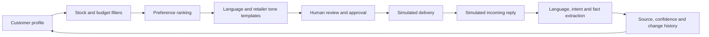

## Gemini chat (enabled when configured)

Set `GEMINI_API_KEY` in the ignored, server-only `.env` and restart the API. `GEMINI_MODEL` defaults to `gemini-3.5-flash-lite`. No client-side key is used. Gemini generates fictional customer replies, extracts source-backed preferences from incoming text, and writes contextual retailer follow-ups. WhatsApp delivery remains simulated. Approving a follow-up or sending a manual retailer reply triggers the next automatic customer turn. Every AI retailer reply still needs human approval. The dashboard labels Gemini mode; API failures visibly fall back to the existing rule-based demo. Tests explicitly force mock mode and never spend API credits. No external model receives other customers' data; only the active customer's recent history and matching catalogue products are sent.

# Factori · Commerce Intelligence

A local full-stack interview demo of a retailer's personal sales assistant. React and TypeScript provide the workspace; an Express API runs recommendation, campaign and conversation workflows; Prisma persists records in SQLite.

**WhatsApp delivery and customer participants are simulated.** With a configured Gemini key, the active customer’s recent conversation and eligible products are sent to Google for natural replies and source-backed memory extraction. Without a key, deterministic rules and templates keep the demo usable. Product links use the reserved `catalogue.example` domain and are illustrative. All contacts, products, consent records and purchases are fictional.

## Run

Requires Node.js **22.15 or later** and npm. No API credentials or external database are needed.

```sh
npm install
npm run db:setup
npm run dev
```

Open **http://127.0.0.1:5173**. The API runs at **http://127.0.0.1:3001**. Both bind to loopback. `db:setup` applies migrations and **resets the demo data**; use it only when you want a fresh walkthrough. Existing data persists in `prisma/dev.db` between server restarts. The UI's Reset demo workspace action restores the same fixtures.

Optional: copy `.env.example` to `.env` to change the SQLite file or API port. Relative SQLite paths resolve from `prisma/`. The default port is 3001; if changing it, update the Vite proxy and allowed development origin in `server/app.ts` as well. No `.env` is required for the default setup.

```sh
npm run build    # strict TypeScript check and optimized frontend build
npm start        # serves the built app and API together on http://127.0.0.1:3001
npm test         # migrates an isolated temporary SQLite DB, then runs API/rule tests
```

`npm test` never resets the presenter's database. `npm start` requires dependencies installed, database initialized, and a successful build. It runs the TypeScript server using tsx, so development dependencies must be available in this local demo.

## Five-minute assessment walkthrough

1. Open Overview. Explore the 12 contacts and 16 apparel products. Catalogue includes a deliberately unavailable item and products above common budgets.
2. Choose **Create a campaign** and **Select demo customers** (Ananya and Kiran), or select both in Contacts. Give the campaign a name and generate recommendations.
3. Compare Ananya's Tanglish and Kiran's Kanglish messages. Prices, links and matching reasons come from catalogue data. Edit a draft; saving removes its approval.
4. Approve individually or approve all pending, then **Send approved**. Delivery is explicitly simulated. Repeating a send never duplicates an already sent draft.
Customer replies now run automatically after campaign delivery, including language detection, preference updates, and pending follow-up generation.

5. Open Ananya's conversation. Her pastel reply is already simulated, her colours updated with source/confidence history, and a contextual follow-up awaits approval.
6. Switch to Kiran. His budget objection is already simulated and his maximum budget is ₹700. The pending follow-up only includes available products within that budget.
7. Create a fresh campaign for both customers. Ananya's picks now prioritise pastels, and Kiran's earlier ₹990 shirt is excluded.
8. Try manual language override, pause, takeover, and **Stop marketing**. Additional incoming-message scenarios, including vague replies and opt-outs, are covered by the API tests.
9. In a customer profile, record a clearly labelled demo purchase of a product from their sent campaign. Analytics updates from stored activity; seeded purchases do not count as campaign conversions.
10. Refresh the browser or restart the API to demonstrate database persistence. Reset the workspace before the next presentation.

## Implemented modules and files

- `src/App.tsx`, `src/styles.css`: seven responsive pages, customer editing, campaign review, chat simulation and analytics.
- `src/api.ts`, `src/types.ts`: typed frontend API boundary and models.
- `server/app.ts`: validated REST endpoints, tenant-scoped resource lookup, approval/consent enforcement and transactional mutations.
- `server/intelligence.ts`, `server/services/`: simulated AI boundary and separate language, memory, recommendation and messaging services.
- `server/adapters/whatsapp.ts`: typed delivery adapter with an explicit simulation receipt.
- `server/db.ts`: database connection and single-demo-retailer identity.
- `server/index.ts`: loopback API and built frontend hosting.
- `prisma/schema.prisma`, `prisma/migrations/`: relational schema and versioned SQL migrations.
- `prisma/seed.ts`: repeatable fixtures, historic conversations and example purchase history.
- `tests/workflow.test.ts`, `scripts/test.mjs`: end-to-end HTTP and business-rule verification on a separate database.
- `public/assets/`: local garment illustrations and brand mark. No runtime image service.

## API overview

All requests use JSON. Invalid input returns `{ "error": "..." }` with an appropriate HTTP status.

| Endpoint | Purpose |
| --- | --- |
| `GET /api/health` | Local readiness |
| `GET /api/workspace` | Retailer, contacts, messages, memory, catalogue, campaigns, metrics |
| `POST /api/campaigns` | Generate drafts for 1–10 distinct consented customers |
| `PATCH /api/drafts/:id` | Edit, approve, reject, restore a draft; edits reset approval |
| `POST /api/campaigns/:id/approve` | Approve pending drafts |
| `POST /api/campaigns/:id/send` | Atomically simulate approved deliveries |
| `PATCH /api/customers/:id` | Correct preferences, language, consent or takeover |
| `POST /api/customers/:id/incoming` | Simulate an inbound message, extract facts, persist memory, create a pending reply |
| `PATCH /api/messages/:id` | Edit/reject or explicitly approve and simulate a pending follow-up |
| `POST /api/customers/:id/manual` | Send a retailer-written simulated message during manual takeover |
| `POST /api/customers/:id/convert` | Record an explicitly simulated purchase |
| `DELETE /api/customers/:id/memory` | Clear preferences/history of preference changes, reset detected language/style, reject unsent drafts; keep conversations |
| `DELETE /api/customers/:id/history` | Clear conversations, purchases, preferences, change history and campaign drafts for that customer |
| `PATCH /api/retailer` | Pause/resume assisted automation |
| `POST /api/reset` | Restore original demo fixtures |

## How the learning loop works



Price, stock and dislikes are deterministic constraints. Preferences rank eligible items; explicitly known categories prevent unrelated recommendations. No match produces an honest clarification message. Explicit statements and manual corrections outrank uncertain inferences; purchase intent is inferred only when a message gives a clear signal. Customer corrections can supersede older explicit preferences.

Language detection checks regional vocabulary and script markers, keeps the prior language when confidence is low, and respects manual overrides. Output templates use Latin script. Retailer tone is inferred from the supplied historical outgoing examples and manually written retailer messages, excluding generated campaigns to prevent feedback drift; customer style comes from incoming messages. Each incoming response invalidates older pending follow-ups, and preference changes invalidate unsent campaign drafts. Outgoing drafts always require retailer approval.

Mutations are serialized within the local server process; campaign sends and memory changes use database transactions. Every resource lookup scopes to the demo retailer, and customers have unique phone identities within that retailer. Browser errors, input limits, consent and unavailable products are handled server-side.

## Scope and limitations

- This is a **single local demo retailer**, without authentication. Tenant columns and scoped queries demonstrate isolation patterns; they are not a substitute for authenticated tenant identity. Do not expose this server publicly as a production service.
- Rule-based language, tone, intent and preference handling is intentionally bounded to demo vocabulary. Confidence values are illustrative heuristics, not calibrated model probabilities. Native scripts can be detected but generated regional responses use Latin templates. Arbitrary conversational understanding needs a real provider adapter and evaluation with native speakers.
- The AI adapter is exported as `simulatedAI`; `simulatedWhatsApp` explicitly marks delivery. To add real providers, separate provider implementations behind these boundaries and keep send validation and approval enforcement on the server.
- The catalogue is seeded and read-only. There are no imports, browsing events, inventory synchronisation, payment processing, webhooks or live purchase integrations.
- Manual takeover suppresses generated replies and blocks sends of AI drafts. A separate retailer composer simulates human-written replies, including while automation is paused. Withdrawn consent blocks all outgoing messages in this demo.
- A plain-language “delete my data” / “forget me” request removes stored conversation content, preferences, purchases and drafts, and withdraws consent. The fictional contact name and phone stay in the contact list. Memory-only deletion intentionally retains conversations; the separate history deletion control removes them.
- Analytics uses actual local campaign sends, approved follow-ups, explicit interest signals, and manually recorded demo conversions. Language delivery charts use the customer's current language. A demo purchase is attributed to the latest sent campaign only if it included that product; conversion counts represent unique customers.
- No real WhatsApp policy engine, template approval, consent verification, messaging-window enforcement or rate limiting is claimed. Those must be added with a real provider. SQLite and a single-process write queue suit this local demonstration, not a distributed deployment.
- No model retraining occurs. Learning updates each customer's structured profile.

## First conversations and WhatsApp pairing demo

Open **WhatsApp connection** and press **Simulate Connection**. The displayed pattern is a non-functional QR-style illustration, visibly marked DEMO. The database persists connecting → syncing → connected, and a page refresh resumes that state. The provider returns twelve fictional contacts and eight historical messages; sync matches identities and avoids duplicate messages or overwriting learned preferences. **Disconnect simulator** preserves customer memory and blocks new sends until reconnection. No WhatsApp Web protocol, QR authentication, Periskope credentials or Meta credentials are used. `WhatsAppAdapter` separates pairing, status polling, syncing, disconnect and delivery; `WhatsAppConnectionService` owns persisted state and merge rules. Replace the adapter for a real provider’s supported authentication and webhook flow.

Open **First conversation** to answer “How do I start selling when I know nothing about this person?” Introduce the store, ask permission, learn a stated interest, then offer actual catalogue options. Select a zero-history sample contact or add a new contact with name, international phone and language. A new contact starts with empty memory and no marketing consent. Review/edit the introduction, confirm permission to start a conversation, and approve its simulated delivery. Gemini (or the offline fallback) provides a fictional customer response. A separate, explicitly simulated opt-in is recorded before promotional follow-ups are generated. Declined permission leaves marketing blocked. The response builds the customer’s first structured preference profile and produces a reviewable follow-up; **Continue conversation** opens that learning loop.

Existing databases upgrade without resetting data using `node scripts/prisma.mjs migrate deploy` and `node scripts/prisma.mjs generate`. `npm run db:setup` resets the entire demo, including connection state. The tests cover persistence, idempotent sync, disconnect enforcement, initial-contact permission, opt-in audit history, and cold-start preference learning.

## Deploy and share an assessment URL

The repository includes `render.yaml` for a Render Node web service, plus a Dockerfile for other container hosts. `npm run start:deploy` creates the SQLite file, applies migrations, seeds only an empty database, and starts the built frontend and API. Existing databases are not reset on ordinary startup. Set `HOST=0.0.0.0`; the hosting provider supplies `PORT`. Render's `RENDER_EXTERNAL_URL` is automatically accepted as the frontend origin; other hosts can set `PUBLIC_ORIGIN` to their exact HTTPS URL.

Render settings:

- Build: `npm ci --include=dev && npm run build`
- Start: `npm run start:deploy`
- Health check: `/api/health`
- Environment: `NODE_ENV=production`, `HOST=0.0.0.0`, `DATABASE_URL=file:./dev.db`, `GEMINI_MODEL=gemini-3.5-flash-lite`
- Add `GEMINI_API_KEY` as a server-side environment secret in the hosting dashboard. Never commit `.env`.

Render's free web service has an ephemeral filesystem and sleeps after inactivity. The URL remains shareable, but SQLite memory, connection state and campaigns reset after a restart/spin-down. The startup script restores sample data in that case. For durable memory, attach a paid persistent disk, set `DATABASE_URL=file:/var/data/factori.db` and mount it at `/var/data`, or use a host with a persistent volume. See [Render free-service limits](https://render.com/docs/free) and [persistent disks](https://render.com/docs/disks). No paid resources are provisioned by these local files.

To deploy manually, upload the source to a GitHub repository, create a Render Web Service from that repository (or apply its Blueprint), enter the settings above and deploy. Share the resulting HTTPS `onrender.com` URL, not localhost. Only upload source files: exclude `.env`, database files, `node_modules`, `dist`, `data`, and artifacts. The provided `.gitignore` and `.dockerignore` cover these paths.

### Campaign send recovery

SQLite writes are serialized across parallel customer jobs and connection sync. Gemini requests can still run concurrently. A campaign records delivery before processing fictional customer replies; each sent draft tracks whether that processing is pending, processed, failed or skipped. If reply processing fails, the API returns the delivery result plus an explicit warning instead of presenting already-sent messages as a failed delivery. Use **Retry customer replies** (the same campaign `/send` endpoint) to recover pending/failed processing without sending campaign messages again. Existing incoming replies are detected to avoid duplicate customer messages. Deployment startup applies the reply-status migration automatically. `/api/health` includes the deployed commit when Render supplies `RENDER_GIT_COMMIT`.

### Automatic sales conversation

Approve a campaign, then choose **Send & simulate to sale**. Both fictional participants continue automatically: preference discovery, available size, explicit purchase confirmation and demo receipt. The knowledge base records preferences, size and the last simulated order; campaign analytics count the demo purchase. All sales are fictional and no payment is processed. Gemini generates both sides when configured; offline templates remain available. Existing sent campaigns have **Simulate to sale / resume**. Pause, takeover, consent withdrawal and disconnect stop automation. Progress survives refresh and running jobs resume on server restart; retries deduplicate orders by campaign draft.

The sales flow starts in the background (`POST /api/campaigns/:id/send` with `{ "simulateToSale": true }`, or `POST /api/campaigns/:id/simulate-sale` for sent campaigns). The original no-body send API retains its single-reply behavior. Conversation polling keeps memory and sales progress visible without waiting for a long HTTP request.
